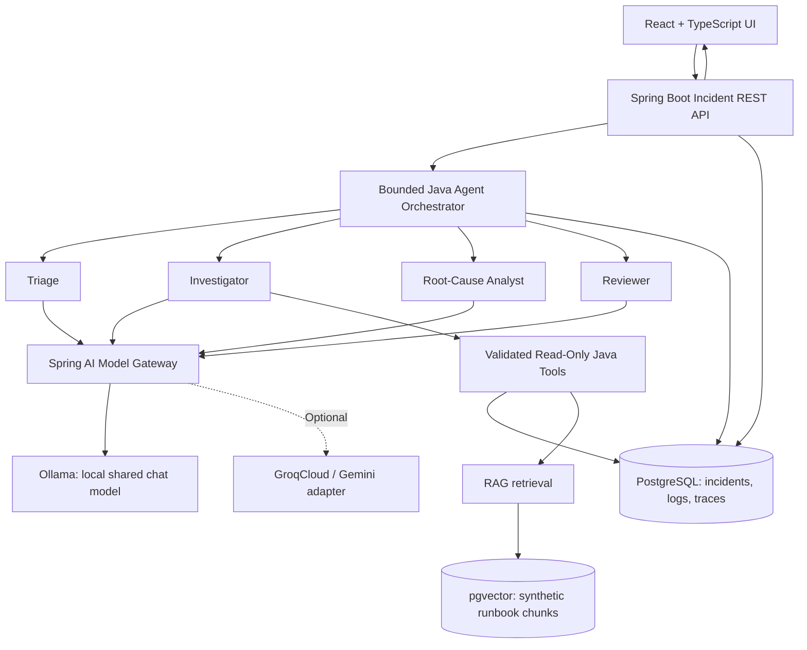

# Architecture (Target Design)

> **Status: Planned, not an as-built diagram.** Update after implementation decisions and validated commits.

## Context

A standalone, local-first incident investigation application. Incident data, logs, deployments, runbooks, and postmortems are **synthetic**, deterministic and retrievable through tools. The AI must not imply it queried real production telemetry.



## Planned modules

| Module | Responsibility |
| --- | --- |
| `backend/` | REST API, orchestration, tools, persistence, RAG, validation |
| `frontend/` | Incident intake, progress, evidence and report visualization |
| `simulator/incidents/` | Seeded synthetic logs, incidents and metadata |
| `simulator/runbooks/` | Synthetic runbooks and historical postmortems |
| `infrastructure/` | Local orchestration (eventually Docker Compose) |
| `evaluations/` | Ground-truth cases and metrics |
| `docs/` | Design and runbook documentation |

These are **target directories**; do not confuse this list with existing files.

## Investigation lifecycle

1. API accepts an incident ID or validated incident data and creates a run ID.
2. **Triage Agent:** categorizes, estimates impact, defines evidence needs.
3. **Investigator Agent:** decides among allowlisted read-only tools: `searchLogs`, `getServiceInfo`, `getRecentDeployments`, `getIncidentHistory`, and runbook search.
4. **Root Cause Agent:** ranks possible causes with supporting evidence IDs, competing hypotheses, missing evidence, and cautious recommendations.
5. **Reviewer Agent:** checks whether claims are supported by retrieved evidence. On failure it may request *one bounded* follow-up pass (limits configurable); otherwise the outcome is “insufficient evidence.”
6. Orchestrator persists status, tool-call metadata, evidence references, errors, timings and final report. UI loads progress via polling or SSE (choice deferred).

Agents are **logical roles, not separate local model processes**. Initially sequential execution shares one model. A dynamic supervisor and parallel evidence collection are optional stretch goals, only after measured benefits.

## Shared state (conceptual)

```text
InvestigationRun {
  runId, incidentId, status, startedAt, finishedAt,
  remainingStepBudget, agentSteps[],
  evidenceRefs[], hypotheses[], unansweredQuestions[],
  report, failureReason
}
```

Use stable evidence IDs for log rows and document chunks. Preserve provenance: service, timestamp/time range, tool name, and document/chunk identifiers. Ground truth belongs only to evaluation data and must not be exposed to agents.

## API sketch (subject to change)

- `POST /api/v1/incidents/analyze`: first milestone, returns typed initial hypotheses without pretending to retrieve logs.
- Later: incident list/detail, investigation initiation, run status, agent step trace and report retrieval endpoints. Exact shapes will be documented from working code.

## Reliability and trust boundaries

- Logs and retrieved text are **untrusted data**, not instructions to agents.
- Only allowlisted read-only tool calls; validate inputs, permitted services, time windows, row counts, output size, and request identity.
- Set hard limits on steps, tool calls, token/context budget, wall-clock time and retries.
- Handle timeout, no-data, missing citations, bad tool arguments, failed JSON parsing and incomplete runs.
- No unrestricted shell commands, secret access, production deployment changes or autonomous write actions.
- Proposed write actions require explicit human approval if ever added.
- Avoid presenting numerical “confidence” without calibration; label hypotheses and uncertainty.

## Operational model

One Spring Boot backend, one React frontend and PostgreSQL/pgvector. Local Ollama normally runs as a single inference runtime; cloud LLM adapters are optional. Avoid Kafka/ELK until they provide demonstrable value for this project's goals.

## Evolution

- **Weeks 1–2:** single analysis API then one tool-calling agent.
- **Week 3:** local embeddings + synthetic runbook RAG.
- **Week 4:** bounded 4-role multi-agent workflow.
- **Week 5:** persistent trace + UI.
- **Week 6:** evaluation, safeguards, portable local demo.
- **Optional:** MCP adapter, controlled parallel tasks, supervisor-led dynamic delegation.

See [MVP Scope](MVP_SCOPE.md), [Decisions](DECISIONS.md), [Evaluation](EVALUATION.md), and [TODO](../TODO.md).
