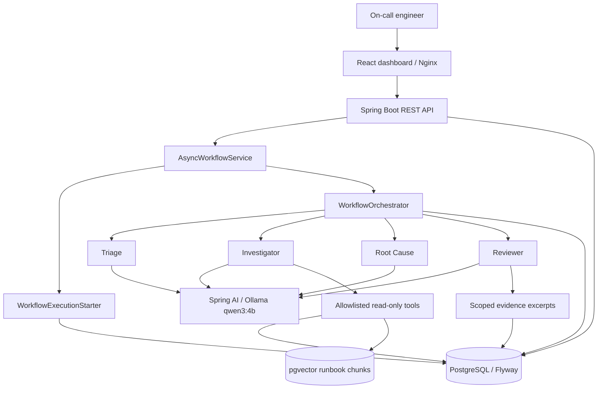
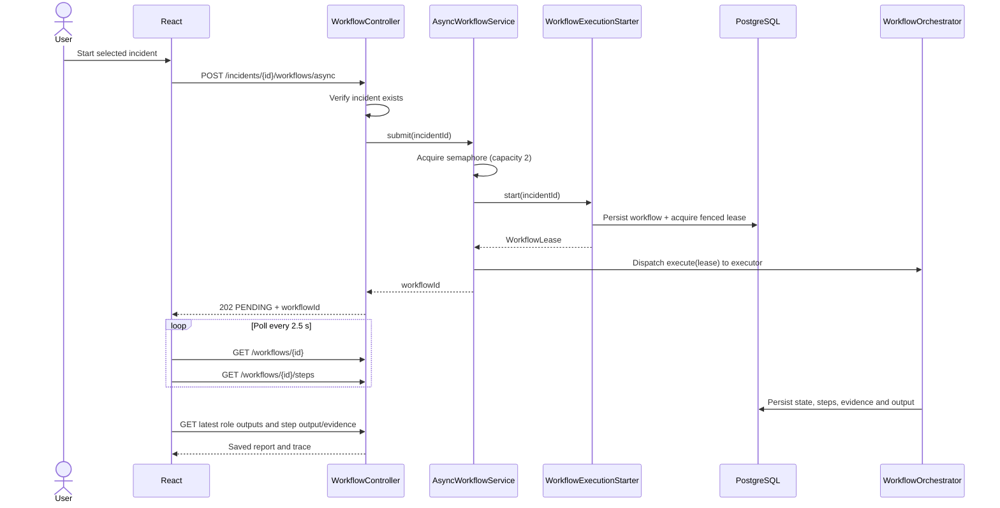
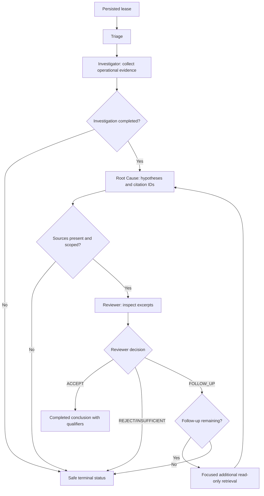

# TracePilot AI — As-built architecture and execution flows

> Source map: `tracepilot-frontend/src/App.tsx`, `src/api.ts`, `tracepilot-backend/src/main/java/com/tracepilot/workflow/`, `investigation/agent/`, `infrastructure/docker-compose.yml`. Contrast with the older conceptual [ARCHITECTURE.md](ARCHITECTURE.md).

## High-level component view

The four agents are **roles**, not four independently hosted models. The frontend is a client, not a source of investigation truth. PostgreSQL records are authoritative for status, step output and evidence references.

## Workflow sequence — asynchronous start

The executor is a two-thread pool, guarded by a semaphore of two simultaneous submissions. Capacity rejection returns HTTP 503 for the async route. If executor dispatch fails *after* workflow creation, `failPendingDispatch(lease)` attempts a fenced `PENDING → FAILED` update; failures in cleanup are escalated, not silently treated as normal capacity rejection.

## Agent execution — decision branch

**Operational detail:** The Investigator performs deterministic incident-centered log collection and can obtain additional service, deployment and historical evidence based on Reviewer questions, then exposes remaining authorized callbacks to the model under the shared tool budget. No arbitrary shell commands or infrastructure write tools are supplied.

**Reviewer:** checks cited IDs within the current investigation scope and inspects source excerpts; a runbook/postmortem alone cannot establish the current operational cause. A structurally valid citation is **not proof** that every sentence is entailed.

## Persistence, bounds and recovery

- Initial workflow creation and lease acquisition are coordinated by `WorkflowExecutionStarter`. Leases use owner identity and fencing tokens to block late/stale writes.
- The orchestrator persists structured handoffs and individual step timings/statuses, enforces a four-minute logical workflow deadline and allows at most one focused follow-up.
- The standard Investigator limits are eight tool calls, six model requests and a cooperative 90-second deadline. Focused follow-up tool budget is four. Each role's deadline is checked around synchronous calls.
- A heartbeat renews active ownership; scheduled recovery reconciles expired workflows. Recovery counters in the Milestone 6 branch are process-local.
- **Critical distinction:** an already-running Ollama call might continue after a deadline. A late result must not be accepted, but this is not hard preemption.

## Trust boundaries

1. **Source to model:** logs, document passages and tool output are untrusted. Redaction is best-effort and does not comprehensively sanitize persisted records or UI output.
2. **Model to application:** parse/validate structured outputs, verify IDs against persisted references, enforce limits and Reviewer decision rules.
3. **UI to REST:** polling and typed API responses; the UI must not infer success simply from HTTP 200 or completed steps.
4. **Demo to production:** no production authentication/authorization or actual remediation approval; only synthetic local data are in scope.

## Failure cases to explain in interviews

| Situation | Observed/intended behavior |
| --- | --- |
| Unknown incident | Reject before scheduling expensive execution |
| Two workflows running and third arrives | Async capacity rejection (503) |
| Executor rejects after persistence | Fenced pending-dispatch cleanup; error surfaced |
| Evidence absent / invalid IDs | Insufficient-evidence or failure path, no invented root cause |
| Reviewer needs more information | At most one focused follow-up, then terminal safe outcome |
| Browser reload during execution | Saved workflow ID supports reconnection without new POST |
| Workflow owner crashes / lease expires | Deadline/recovery and fenced ownership protect persisted state |
| Inference exceeds logical deadline | Late result rejected; underlying synchronous inference might continue |

## Further reading

[API walkthrough](TRACEPILOT_API_WALKTHROUGH.md) · [Integration guide](TRACEPILOT_INTEGRATION_GUIDE.md) · [Main guide](TRACEPILOT_GUIDE.md).
