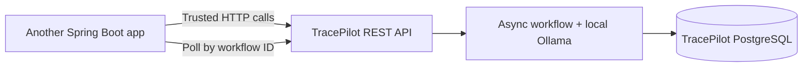

# TracePilot AI — Integrating with another application

> Integration **design guidance**, not a claim that production connectors or an embeddable SDK already exist. The current system uses synthetic local incident data and has no production authentication/authorization; use a trusted local development environment only.

## 1. Three integration approaches

| Approach | Code change | Best fit | Status |
| --- | --- | --- | --- |
| **A. Consume TracePilot REST API** | Calling app adds an HTTP client and workflow ID tracking | Separate Spring Boot service or internal local tool | Works against currently available demo endpoints, provided incident IDs already exist in TracePilot |
| **B. Adapt read-only evidence repositories/tools** | Implement connectors mapping your application's authorized data to TracePilot's incident/evidence model | New source systems, logs, deployments and metadata | **Requires new development** |
| **C. Extract orchestration into a reusable module** | Separate workflow, persistence and model contracts; publish a versioned Java library | Multiple internal applications needing orchestration | **Architectural proposal**, not a shipped library |

**Important:** API consumption does not magically ingest incidents from your other project. The current REST workflow accepts a TracePilot incident ID for a record already present in its repository. Real incident provisioning and adapters must be implemented before cross-project operational use.

## 2. Option A — HTTP service integration (lowest coupling)

Architecture:



Development flow:

1. Run TracePilot's Docker Compose stack on a trusted machine.
2. Start with an incident already seeded into its PostgreSQL database.
3. POST `/api/v1/incidents/{incidentId}/workflows/async`, store `workflowId` and recognize the 202 status.
4. Poll `GET /api/v1/workflows/{workflowId}` with a bounded delay and overall deadline.
5. Read `/steps`, `/outputs/ROOT_CAUSE`, `/outputs/REVIEWER`; load per-step evidence references when needed.
6. Treat terminal `INSUFFICIENT_EVIDENCE` as an explicit *non-diagnosis*. Preserve IDs so users can audit.
7. Do not auto-apply any suggested remediation.

### Example Java 21 client (illustrative)

```java
var client = java.net.http.HttpClient.newHttpClient();
String base = "http://localhost:8080/api/v1";
String incidentId = "INC-DB-001";
var post = java.net.http.HttpRequest.newBuilder(
        java.net.URI.create(base + "/incidents/" + incidentId + "/workflows/async"))
    .header("Accept", "application/json")
    .POST(java.net.http.HttpRequest.BodyPublishers.noBody())
    .timeout(java.time.Duration.ofSeconds(15))
    .build();
var accepted = client.send(post, java.net.http.HttpResponse.BodyHandlers.ofString());
if (accepted.statusCode() != 202) {
    throw new IllegalStateException("Submission rejected: HTTP " + accepted.statusCode());
}
// Parse workflowId from accepted.body() using Jackson; persist it in your application.
// Poll GET /workflows/{workflowId}; examine status before reading report outputs.
// Do not automatically repeat POST on a network timeout: creation may have succeeded.
```

The snippet intentionally leaves workflow UUID parsing and polling to the host application's error-handling strategy. It is an illustration, not a packaged TracePilot SDK.

### When HTTP integration helps

It preserves loose coupling and independent deployment. Your client can offer an "Investigate with TracePilot" button while leaving evidence access, workflow execution and storage inside the TracePilot service.

### Limits and risks

No cross-service authentication or tenant isolation, no built-in data ingestion contract, no public API stability promise and no webhooks/SSE. Do not open the demo API to external networks as-is. Use a secured gateway, identity/authorization, incident ownership checks, audit logging and request limits before a production adaptation.

## 3. Option B — data/tool adapters (development required)

Today the Investigator's allowed operations include `searchLogs`, `getServiceInfo`, `getRecentDeployments`, `getIncidentHistory` and synthetic runbook search. For another project, implement **read-only** adapters to authorized data sources while retaining:

- A canonical incident ID/service identity and incident-scoped access.
- Stable evidence IDs and immutable source/time metadata.
- Strict query validation, time-window and result count bounds.
- Per-run evidence persistence before citations can be accepted.
- Redaction/minimization before any content reaches the model.
- Separate ground truth and predictions for evaluations.

For example, a payment backend might expose *sanitized* HTTP error summaries and deployment metadata through an adapter; the model should not receive raw payment tokens or customer profiles.

Connectors to Elasticsearch, OpenTelemetry, Kafka or external observability providers are **not implemented** by this guide.

## 4. Option C — extract an orchestration library (proposal)

If two or more products need the same pipeline, a future internal module could define `IncidentSource`, `EvidenceProvider`, `InvestigationToolRegistry`, `WorkflowStore`, `ModelClient` and `ReviewPolicy` interfaces. Move Java implementations incrementally after stable tests and use versioned schema/DTO contracts.

Avoid extracting everything now solely for reuse: the existing workflow is coupled to Spring persistence, local Ollama configuration and domain-specific evidence classes.

## 5. Practical client-adoption sequence

**Discovery:** identify incident volume, data classification, accepted latency, compliance, current observability tools and the human decision process.

**Proof of concept:** ingest a *sanitized test subset*, define independently labeled causes and safe-abstention scenarios, measure end-to-end evidence fidelity and operator review time.

**Hardening:** authentication, per-tenant isolation, rate limits, secrets controls, logging/retention, deletion, model and embedding lifecycle, failure handling, timeout guarantees and human-governed remediation policy.

**Rollout:** shadow-mode advisory use first; compare human-reviewed results to a baseline before exposing any production workflows.

## 6. Source references

See [REST walkthrough](TRACEPILOT_API_WALKTHROUGH.md), [architecture](TRACEPILOT_ARCHITECTURE.md), `tracepilot-backend/src/main/java/com/tracepilot/investigation/agent/InvestigationToolCallbackFactory.java`, and `tracepilot-backend/src/main/java/com/tracepilot/workflow/orchestration/`.
